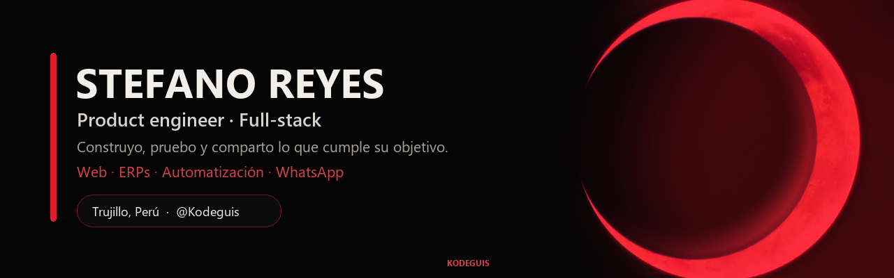
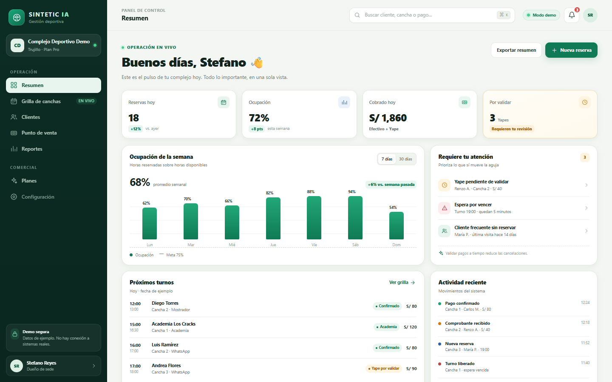
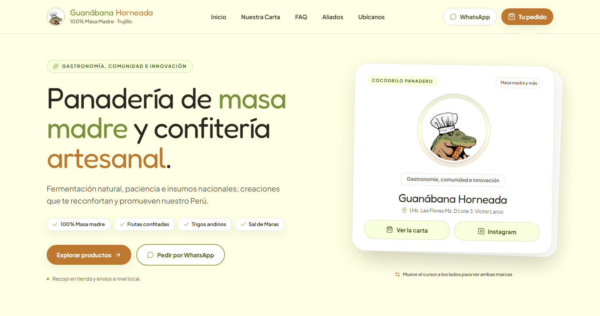

 

### Hola, soy Stefano 👋

**Construyo productos web, sistemas de gestión y automatizaciones que resuelven operaciones reales.**

Me gusta probar, romper, iterar y **compartir cuando algo cumple su objetivo**.  
Lo que todavía no está listo se queda en el laboratorio. Lo que sí, sale a la luz.

 

## 🧭 Qué hago

- **Productos web**: landings, dashboards y aplicaciones con foco en claridad y velocidad.
- **Sistemas de gestión**: pedidos, stock, clientes, caja y reportes para negocios reales.
- **Automatización**: flujos, integraciones y **bots de WhatsApp** que reducen trabajo manual.
- **Full-stack**: React + TypeScript en el frontend; Node, Supabase, PostgreSQL y Docker en el backend.

Me interesa menos “hacer una web” y más **entender el problema, probar una solución y dejarla funcionando**.

## 🧪 Cómo trabajo

> **Probar → medir → iterar → compartir.**

1. **Pruebo rápido.** Prefiero un prototipo real a una presentación perfecta.
2. **Itero con el usuario.** El producto se corrige con uso, no con suposiciones.
3. **Comparto cuando cumple su objetivo.** No publico todo lo que empiezo; publico lo que ya resuelve algo.
4. **Mantengo privado lo que está en el horno.** Proyectos, clientes y experimentos se quedan en privado hasta que estén listos para salir.

## 🚀 En el taller

| Línea de trabajo | Qué es | Estado |
|---|---|---|
| **Productos para negocios** | Sistemas de pedidos, stock, clientes y automatización para operaciones reales. | 🔒 Privado hasta su lanzamiento |
| **Sintetic IA Showcase** | Demo visual de un SaaS de gestión para complejos deportivos. | 🌐 Público |
| **Experimentos** | Prototipos de UI, bots y automatizaciones que pruebo antes de compartir. | 🧪 Laboratorio |

## 📌 Proyectos propios

<table>
  <tr>
    <td width="50%" valign="top">
      
        
      <b>Sintetic IA — Showcase</b> 
      Demo visual y funcional de un sistema de gestión para complejos deportivos. Datos ficticios, sin backend.
        
      <a href="https://kodeguis.github.io/sintetic-ia-showcase/">🌐 Ver demo</a> ·
      <a href="https://github.com/Kodeguis/sintetic-ia-showcase">Código</a>
    </td>
    <td width="50%" valign="top">
      <b>Inventario-S</b> 
      Sistema de inventario con React + Vite. Un ejercicio de producto para ordenar stock y movimientos.
        
      <a href="https://inventario-s.vercel.app">🌐 Ver demo</a> ·
      <a href="https://github.com/Kodeguis/Inventario-S">Código</a>
    </td>
  </tr>
</table>

## 🧩 Trabajo de cliente

**Landing para una panadería artesanal** — React, Vite, Tailwind y Supabase. Un trabajo de cliente, no mi identidad: diseño, catálogo y pedido por WhatsApp.

<a href="https://github.com/Kodeguis/Landing-Guanabana">Ver repositorio</a> · <a href="https://kodeguis.github.io/Landing-Guanabana/">Ver demo</a>

## 🛠️ Stack

## 📈 Actividad

## 🔒 Sobre lo privado

No todo lo que hago está acá. Trabajo en productos y sistemas para negocios que **se mantienen privados hasta que están listos para operar**. Cuando un proyecto cumple su objetivo, lo cuento, lo muestro o lo abro.

Si algo no está público, no significa que no exista: significa que todavía se está probando.

## 📬 Hablemos

¿Tienes un producto, un proceso que ordenar o una idea que probar?

- Abre un **issue** o escríbeme por GitHub.
- También puedes revisar mis repos públicos y ver en qué estoy trabajando.

 

  Hecho con curiosidad y código. 🌙

